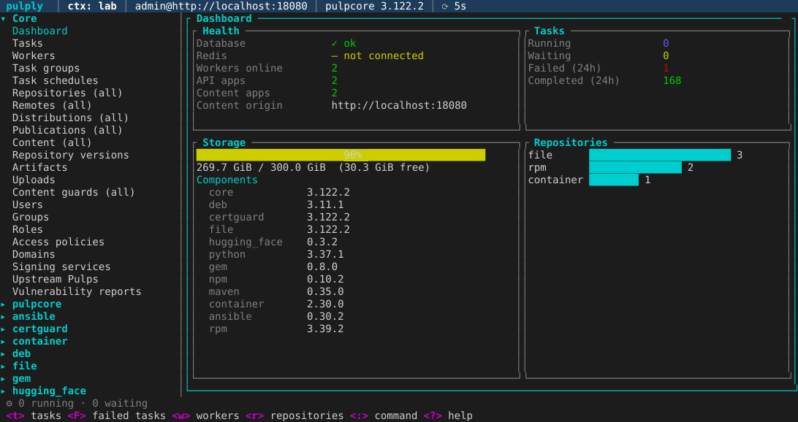
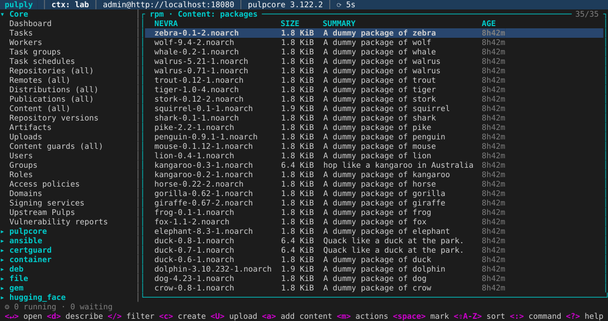
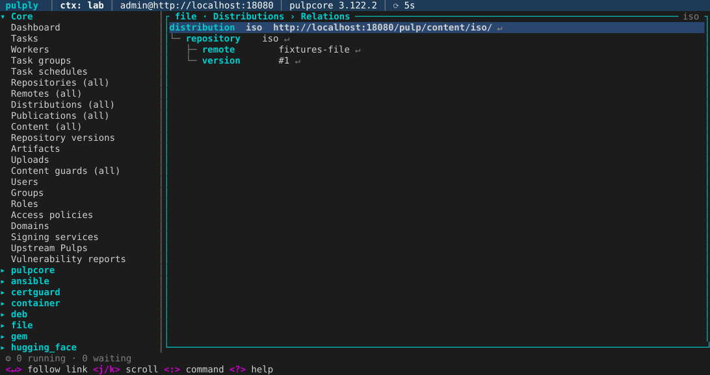
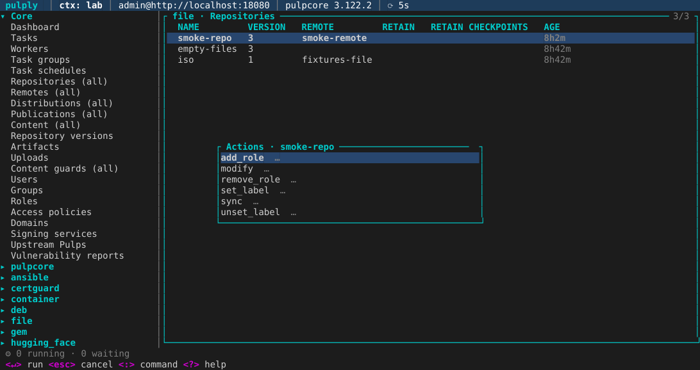

# pulply

Terminal UI to observe and manage [Pulp 3](https://pulpproject.org) servers, in the spirit of
[k9s](https://k9scli.io). Built with Rust and [ratatui](https://ratatui.rs).

Every resource type exposed by the server (all installed plugins) is discovered from its OpenAPI
schema and browsable from the sidebar or the `:` command line.

Status: milestones M1 (observe), M2 (create/edit/delete, workflows), M3 (plugin views, upload, diff,
relations) and M4 (RBAC, administration, customization, packaging) done. See [`docs/spec/`](docs/spec/)
for requirements, design and roadmap.



| RPM packages (NEVRA) | Relations (`X`) | Action menu (`m`) |
|---|---|---|
|  |  |  |

## Install

| Channel | Command |
|---|---|
| crates.io | `cargo install pulply` |
| Shell installer (Linux, macOS) | see the [latest release](https://github.com/brazok/pulply/releases/latest) |
| Debian / Ubuntu | `sudo apt install ./pulply_<version>-1_amd64.deb` (release asset) |
| Fedora / RHEL | `sudo dnf install ./pulply-<version>-1.x86_64.rpm` (release asset) |
| Container | build it locally: `podman build -t pulply -f Containerfile .` |

From source:

```sh
cargo build --release
./target/release/pulply --help
```

Requires pulpcore ≥ 3.50.

## Configuration

pulply reads `~/.config/pulply/config.toml` and imports every profile of pulp-cli's
`~/.config/pulp/cli.toml` (`[cli]` → context `default`, `[cli-lab]` → `lab`).

```toml
language = "fr"            # optional, else system locale (fr / en)
start_view = "dashboard"   # or any command, e.g. "repo rpm", "task"
refresh = 5                # seconds
upload_chunk_size = "6MiB" # chunk size for uploads
import_pulp_cli = true
skin = "dark"              # built-in dark / light, or ~/.config/pulply/skins/<name>.toml
default_context = "prod"

[contexts.prod]
base_url = "https://pulp.example.com"
username = "admin"         # password from ~/.netrc, PULPLY_PASSWORD, or prompted
readonly = true
skin = "prod-red"          # per-context skin
verify_ssl = "/etc/pki/tls/certs/ca-bundle.crt"   # or true / false

[contexts.lab]
base_url = "http://localhost:8080"
username = "admin"
password = "password"
api_root = "/pulp/"        # default
domain = "acme"            # optional, ignored unless the server enables domains ("default" then)
```

CLI flags: `--context`, `--config`, `--readonly`, `-c/--command`, `--refresh`, `-l/--log-level`.
Logs go to `$XDG_STATE_HOME/pulply/pulply.log` (`~/.local/state/pulply/` on Linux). Past 10 MB the file
is moved to `pulply.log.1`, replacing the previous one, so logs never take more than 20 MB.

### Customization

Files next to `config.toml` (the directory of `--config` when given):

```toml
# skins/prod-red.toml: colors by name, "#rrggbb" or ANSI index; unset ones come from `inherit`
inherit = "light"
header_bg = "#aa0000"
header_fg = "white"

# hotkeys.toml: key → `:` command (hotkeys win over view keys)
"shift-1" = "repo rpm"
F2 = "task"

# aliases.toml: extra `:` words
rr = "repo rpm"

# views.toml: columns per resource type id (as in `:` completion), JSON paths allowed
["repositories/rpm/rpm"]
columns = ["name", "latest_version_href", { path = "pulp_labels.env", header = "ENV" }, "pulp_created"]

# plugins.toml: external commands on the selected resource
[plugins.browse]
key = "ctrl-o"
description = "open in browser"
scopes = ["distributions"]      # type ids, categories, plugin names or "all"
command = "xdg-open"
args = ["$DIST_URL"]
background = true               # else the TUI is suspended until Enter is pressed
```

Skin colors: `muted accent border border_focus header_bg header_fg selection_bg success warning error
info key` (see [`crates/pulply/skins/dark.toml`](crates/pulply/skins/dark.toml)). Plugin variables:
`$HREF $NAME $TYPE $PRN $BASE_URL $API_URL $CONTEXT $DIST_URL $USER`, also exported as `PULPLY_<NAME>`.

### Permissions

pulply only offers the actions the connected user may perform: staff users see everything; other
users get their global permissions from their roles (when readable) and object permissions from each
resource's `my_permissions/`. A refused request shows "Permission denied". `rbac_filter = false` on a
context disables the filtering. `:me` shows the user, how it is filtered and its readable roles.

## Keys

Browse:

| Key | Action |
|---|---|
| `:` | command mode (`:repo rpm`, `:content container/tags`, `:dist`, `:task`, `:user`, `:group`, `:role`, `:me`, `:ctx`, `:q`); `Tab` completes |
| `/` | filter rows; `-q <expr>` and `-f key=value` are sent to the API |
| `Enter` / `Esc` | drill down (repository → versions → content) / back |
| `d` | describe (follow hrefs with `Enter`) |
| `Shift`+letter | sort by the column starting with that letter (unless bound to an action below) |
| `f` | cycle task state filter (task list) |
| `Tab` / `Ctrl-B` | focus / toggle sidebar |
| `Ctrl-R` / `p` | refresh now / pause polling |
| `[` / `]` | history back / forward |
| `?` | help |
| `x` | diff a version with its predecessor, or the two marked versions |
| `X` | relations tree of a distribution, publication, version or repository |
| `q` / `Ctrl-C` | quit |

Manage (hidden and refused with `--readonly` or `readonly = true`):

| Key | Action |
|---|---|
| `c` / `u` | create / edit with a form generated from the server schema (`Ctrl-S` submits) |
| `e` | edit as YAML in `$VISUAL`/`$EDITOR` (changed fields are PATCHed) |
| `Space` / `Ctrl-D` | mark rows / delete marked rows (or the current one), after confirmation |
| `s` / `P` / `D` | sync / publish / distribute a repository (`P`, `D` also on versions and publications) |
| `R` | rollback: new version with the content of the selected version |
| `a` / `r` | add content (from a version's content, or marked content to a chosen repository) / remove marked content |
| `U` | upload local files (on a repository row or in a content list); content is created and added to the repository |
| `Ctrl-K` | cancel task |
| `:purge` `:orphans` `:reclaim` `:repair` | global operations, after confirmation |
| `m` | menu of every action of the resource (`reset` access policy, `replicate` upstream Pulp, `exports`, `imports`, `set_label`…) |
| `o` | role assignments on the resource (`a` add / `r` remove users and groups) |
| `c` in group users / user roles | add a member / assign a role (`Ctrl-D` removes it) |

Tasks started from pulply open a progress window (`Esc` detaches it), are followed in the status
bar and notify on completion; a distribution's URL is shown once created.

## Development

```sh
PULP_PORT=8080 docker compose -f deploy/compose.yml up -d   # admin / password
cargo test --workspace
```

### Release

Pushing a `v<version>` tag runs `.github/workflows/release.yml` (generated by
[cargo-dist](https://opensource.axo.dev/cargo-dist/) from `dist-workspace.toml`; regenerate it with
`dist generate` after changing the config). It builds the Linux (gnu, musl) and macOS archives for
x86_64 and aarch64, the shell installer, the `.deb` / `.rpm` packages (`build-packages.yml`), creates
the GitHub Release with the notes of `CHANGELOG.md`, then publishes `pulply-api` and `pulply` to
crates.io (`CARGO_REGISTRY_TOKEN` secret).

The Homebrew formula (`brazok/homebrew-tap`, `HOMEBREW_TAP_TOKEN` secret) and the `ghcr.io` image
(`publish-image.yml`) publish jobs are disabled for now: add `"homebrew"` and `"./publish-image"` back to
`publish-jobs` in `dist-workspace.toml` and run `dist generate` to enable them.

Local checks: `dist plan`, `cargo deb -p pulply`, `cargo generate-rpm -p crates/pulply`,
`cargo package --workspace`, `podman build -f Containerfile .`.
