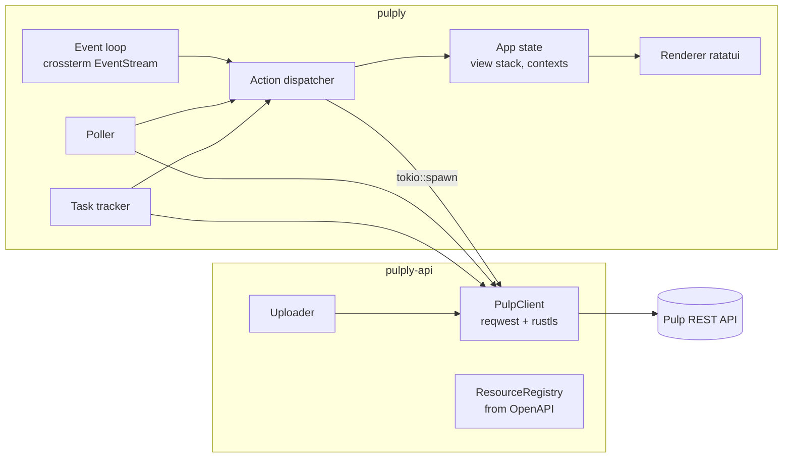

# pulply — Conception

Référence : `requirements.md` (identifiants `Rx.y`).

## 1. Architecture

Workspace Cargo à deux crates : la logique Pulp reste testable sans terminal.

```
pulply/
├── Cargo.toml                 # workspace
├── crates/
│   ├── pulply-api/            # client HTTP, registre OpenAPI, modèles, tâches, upload
│   └── pulply/                # binaire TUI (ratatui + crossterm)
│       ├── locales/           # en.yml, fr.yml (dans la crate pour être publiés sur crates.io)
│       └── skins/             # dark.toml, light.toml (embarqués, même raison)
├── deploy/compose.yml         # pulp/pulp pour dev + tests d'intégration
└── docs/spec/
```



### Boucle d'événements (R3.8)

- `tokio` multi-thread. Une boucle principale `select!` sur : événements terminal, `mpsc<Msg>` (résultats réseau, noms résolus, compteurs de tâches), tick de 250 ms (polling, expiration des notifications).
- Toute requête réseau est un `tokio::spawn` qui renvoie un `Msg` ; le thread de rendu ne fait jamais d'I/O.
- Les requêtes d'une vue sont annulées (`AbortHandle`) quand elle quitte la pile ; les messages d'un contexte précédent sont ignorés grâce à un numéro de génération (R5.5).

### Modèle d'état

- `App { config, session: Option<Session>, stack: Vec<Slot>, sidebar, prompt, names: NameCache, notice, … }`.
- `Session { client: PulpClient, status: Status, registry: Option<Arc<Registry>>, refresh }`, recréée à chaque `:ctx` (R1.4) ; le registre arrive en tâche de fond.
- Pas de table de capacités : `Status::supported()` (≥ 3.50) pilote l'avertissement (R1.7) et l'ETag est utilisé dès que le serveur renvoie l'en-tête (R5.3).
- Trait `View` : `title()`, `info()`, `hints()`, `handle_key() -> Outcome`, `render()`, `fetch(FetchKind) -> Option<Fetch>`, `on_data()`, `poll_interval()`, `set_filter()`.
- `NameCache` (href/PRN → nom) alimenté par chaque payload, complété à la demande (`Outcome::Resolve`, PRN résolus par type via `?prn__in=`).

## 2. pulply-api

### Client (R1.2, R1.3, R5.3)

- `reqwest` + `rustls`, `verify_ssl` : `false` → `danger_accept_invalid_certs`, chemin → CA ajoutée.
- URL : `base_url + api_root + [domain/] + api/v3/…`. Les hrefs renvoyés par Pulp sont absolus (chemin) et utilisés tels quels.
- Domaine (R1.8, R1.9) : `status/` et `docs/api.json` sont lus sans domaine (pulpcore les sert hors domaine). Après le statut, `PulpClient::with_domains(domain_enabled)` fixe le préfixe : domaine configuré ou `default` si activé, aucun sinon. Même règle que pulp-glue (`x-pulp-domain-enabled`), mais lue dans le statut, disponible avant le schéma. `with_domains` renvoie le domaine ignoré pour la notification ; `default` n'est pas signalé (`pulp config create` l'écrit partout).
- Basic auth. Ordre de résolution du mot de passe : config → netrc (parseur interne, ~60 lignes, pas de dépendance non maintenue) → `PULPLY_PASSWORD` → prompt.
- Cache ETag par URL (`LruCache<Url, (ETag, Bytes)>`) quand `caps.etag`.
- `readonly` est appliqué dans le client : toute méthode mutante renvoie `Error::ReadOnly` avant l'envoi (R13.1), ce qui garantit le comportement même en cas d'oubli côté UI.
- Erreurs typées : `Http { status, body }`, `Validation(HashMap<field, Vec<msg>>)` (400, R7.7), `Forbidden` (403, R12.3), `NotFound`, `Network`, `ReadOnly`.

### Registre OpenAPI (R2)

- Récupère `api/v3/docs/api.json`, cache dans `$XDG_CACHE_HOME/pulply/<hash(base_url)>/<hash(versions)>.json` (R2.2).
- Désérialisation partielle avec `serde` (seulement `paths`, `components.schemas`, `parameters`) : schéma Pulp ≈ 5-10 Mo, parse en un seul passage, sans dépendre d'une crate OpenAPI complète.
- Classification des chemins de liste `…/api/v3/{category}/{plugin}/{type}/` :

| Motif | ResourceKind |
|---|---|
| `repositories/{p}/{t}/` | Repository (+ `versions/` imbriqué) |
| `remotes/{p}/{t}/` | Remote |
| `distributions/{p}/{t}/` | Distribution |
| `publications/{p}/{t}/` | Publication |
| `content/{p}/{t}/` | Content |
| `acs/{p}/{t}/` | AlternateContentSource |
| `contentguards/{p}/{t}/` | ContentGuard |
| `exporters/…`, `importers/…` | Exporter / Importer |
| `tasks/`, `workers/`, `users/`, `groups/`, `roles/`, `access_policies/`, `signing-services/`, `task-schedules/`, `upstream-pulps/`, `uploads/`, `artifacts/`, `orphans/`, `repair/` | Core |

- `ResourceType { id: "repositories/rpm/rpm", category, plugin, kind, list_path, ops: OpSet, actions: Vec<ActionOp>, list_params: Vec<Param>, create_schema, update_schema, read_schema }`.
- Les actions sont les opérations POST sur `{href}<verbe>/` (`sync`, `modify`, `add_role`, `remove_role`, `list_roles`, `my_permissions`, `replicate`, `export`, `import`…), détectées par `operationId`.
- `FormSchema` dérivé du `requestBody` : champs `{ name, ty: Str|Int|Bool|Enum(Vec)|Href(target)|Json|Array(..)|File, required, default, write_only, read_only, nullable, help }`. La cible d'un `Href` est déduite du nom de champ et de la description, avec une table de correspondance (`remote` → remotes du même plugin, `repository` → repositories, `publication`, `content_guard`, `signing_service`…).

### Modèles

- Génériques : `serde_json::Value` + accesseurs (`pulp_href`, `name`, `pulp_created`, …).
- Typés seulement là où la logique en dépend : `Status`, `Task`, `ProgressReport`, `TaskGroup`, `RepositoryVersion`, `ContentSummary`, `Upload`.

### Tâches (R6)

- `TaskTracker` : ensemble de hrefs suivis ; interrogés toutes les 1 s tant que `waiting|running|canceling` (R5.2) ; émet `Action::TaskUpdated` / `TaskFinished`.
- Toute réponse 202 `{task}` passe par `client.spawn_task()` → enregistrement automatique dans le tracker → modal (R6.3).

### Upload (R9)

1. `POST uploads/ {size}`.
2. `PUT {upload_href}` par chunks (`Content-Range: bytes a-b/total`, multipart `file`), sha256 calculé en streaming.
3. `POST {upload_href}commit/ {sha256}` → tâche → artefact.
4. `POST content/{p}/{t}/ {artifact, …champs requis}` (ou `upload` direct si l'endpoint l'accepte), avec `repository` optionnel pour l'ajout immédiat.

Progression par `watch::channel` → barre dans la TUI. Chunk par défaut : 6 MiB (R9.4).

### Diff de versions (R10)

- Résumé : `content_summary.{added,removed,present}` de chaque version.
- Versions consécutives : `content/?repository_version_added=<v>` et `…_removed=<v>` sur chaque type présent.
- Versions arbitraires : liste paginée de `pulp_href` par type pour A et B (`repository_version=`, `fields=pulp_href`), différence d'ensembles, puis récupération des détails par lots (`pulp_href__in`).

## 3. pulply (TUI)

### Disposition (R3.1)

```
┌ ctx: prod │ admin │ pulpcore 3.122 │ RO │ ⟳ 5s ───────────────────────────┐
│ ▾ Core      │ Repositories › rpm › rhel9-baseos › versions               │
│   Dashboard │ ┌─────────────────────────────────────────────────────────┐ │
│   Tasks     │ │ NAME          VERSION  REMOTE        CREATED            │ │
│ ▾ rpm       │ │ rhel9-baseos  12       rhel9-cdn     2026-10-19 08:12   │ │
│   Repos     │ │ …                                                       │ │
│   Remotes   │ └─────────────────────────────────────────────────────────┘ │
│ ▸ container │                                                             │
├─────────────┴─────────────────────────────────────────────────────────────┤
│ ⚙ 2 running: sync rhel9-baseos 43% · publish epel9         ✔ dist created │
│ <s>sync <P>publish <D>distribute <c>create <e>edit <^d>delete <?>help     │
└───────────────────────────────────────────────────────────────────────────┘
```

### Vues

- `GenericListView(ResourceType)` : colonnes par défaut = `name` + champs scalaires courants du `read_schema` (`base_path`, `url`, `latest_version_href` → numéro, `pulp_created`), surchargées par `views.toml` (R14.4).
- `GenericDetailView` : describe (R3.7), onglets selon le type (versions, contenu, rôles).
- `DashboardView`, `TaskListView`, `TaskDetailView`, `ContextView`, `XrayView`, `DiffView`, `FilePickerView`, `FormView`, `ConfirmModal`, `TaskModal`, `HelpView`.
- Vues plugin (R11) : trait `PluginView { fn columns(&self, kind) -> Option<Vec<Column>>; fn describe(..); fn extra_actions(..) }`, enregistrées par identifiant de plugin ; résolution : vue plugin → générique.

### Clavier

| Touche | Action | Touche | Action |
|---|---|---|---|
| `:` | commande | `/` | filtre |
| `Entrée` / `Échap` | descendre / remonter | `[` `]` | historique |
| `?` | aide | `Tab` / `Ctrl-B` | sidebar |
| `d` | describe | `c` / `u` / `e` | create / form edit / `$EDITOR` |
| `Ctrl-D` | delete | `Espace` | multi-sélection |
| `s` / `P` / `D` | sync / publish / distribute | `a` / `r` | ajouter / retirer contenu |
| `R` | rollback | `x` / `X` | diff / xray |
| `U` | upload | `Ctrl-K` | cancel task |
| `Ctrl-R` / `p` | refresh / pause | `Shift+lettre` | tri |
| `q` / `Ctrl-C` | quitter | `m` / `o` | menu des actions / rôles de la ressource |

Les touches ne sont affichées que si l'action est disponible pour le type (`OpSet`) et permise (readonly, permissions).

### Permissions (R12.3)

`perms::load` à la connexion : utilisateur staff → aucun filtrage ; rôles globaux lisibles (`users/<id>/roles/` et ceux des groupes, sans `content_object`) → permissions globales ; sinon (politique Pulp par défaut pour un non-admin) permissions d'objet seules. Les permissions d'objet viennent de `<href>my_permissions/`, chargé à la sélection d'une ligne et à l'ouverture d'un describe ; tant qu'elles sont inconnues, l'action est masquée. La création n'est filtrée que si les permissions globales sont connues. Une 403 affiche « Permission refusée ». `rbac_filter = false` par contexte désactive le filtrage.

### Édition externe (R7.5)

Suspension de la TUI (`LeaveAlternateScreen`, raw mode off), fichier temporaire YAML (`serde_norway`) contenant uniquement les champs non `readOnly`, `$EDITOR`, restauration, diff avec l'original → `PATCH` des champs modifiés.

### Polling (R5)

`PollSpec { key, interval, request }` fourni par la vue active ; le `Poller` gère un seul timer par vue visible, applique la pause, et relance immédiatement sur `Ctrl-R`.

## 4. Configuration

`~/.config/pulply/config.toml` :

```toml
language = "fr"            # optionnel, sinon locale
start_view = "dashboard"   # ou "repo rpm", "task"
refresh = 5
skin = "dark"
upload_chunk_size = "6MiB"
import_pulp_cli = true     # importe ~/.config/pulp/cli.toml

[contexts.prod]
base_url = "https://pulp.example.com"
username = "admin"         # mot de passe via netrc
readonly = true
skin = "prod-red"

[contexts.lab]
base_url = "http://localhost:8080"
username = "admin"
password = "password"
```

Fichiers annexes, dans le répertoire de `config.toml` (R14) : `hotkeys.toml` (touche → commande `:`, prioritaire sur les touches de vue), `aliases.toml` (premier mot de la commande), `views.toml` (colonnes par identifiant de type, chemins JSON pointés), `plugins.toml` (`[plugins.<nom>]` : `key`, `description`, `scopes`, `command`, `args`, `background`), `skins/*.toml` (couleurs du `Theme`, `inherit` d'un autre skin). Plugins au premier plan : `ratatui::restore()`, lecture des événements coupée, attente d'Entrée, puis `ratatui::init()`.

## 5. Dépendances principales

| Besoin | Crate |
|---|---|
| UI | `ratatui` 0.30, `crossterm` |
| Async / HTTP | `tokio`, `reqwest` (rustls, stream, multipart), `tokio-util` |
| Sérialisation | `serde`, `serde_json`, `toml`, `serde_norway` (YAML) |
| CLI | `clap` (derive) |
| Saisie | `tui-textarea` (champs JSON/multiligne) |
| i18n | `rust-i18n` + `sys-locale` |
| Chemins | `directories` |
| Hash | `sha2` |
| Erreurs / logs | `thiserror` (api), `color-eyre` (bin), `tracing`, `tracing-appender` |
| Tests | `insta` (snapshots `TestBackend`), `wiremock`, `tokio::test` |

## 6. Stratégie de test

- **Unitaires** (`pulply-api`) : classification du registre et génération de `FormSchema` sur un `api.json` réel capturé depuis `pulp/pulp` (fixture versionnée), parseur netrc, fusion cli.toml + config, calcul de diff, découpage en chunks.
- **Client** : `wiremock` pour 202/tâches, 304 ETag, 400 validation, 403, readonly qui bloque l'envoi.
- **TUI** : snapshots `insta` du rendu des vues sur `TestBackend` avec données fixtures ; tests de keymap (actions masquées en readonly).
- **Intégration** : `deploy/compose.yml` (image `pulp/pulp`, plugins inclus) ; scénario complet file + rpm : créer remote → repo → sync → publish → distribute → upload → modify → diff → rollback → delete ; exécuté en CI (job séparé).

## 7. Distribution (R16.3)

- `cargo-dist` : GitHub Releases multi-cibles + installateur shell + tap Homebrew.
- `cargo-deb`, `cargo-generate-rpm` dans le workflow de release.
- `Containerfile` multi-stage (musl statique, image `scratch`/distroless).
- Publication crates.io : `pulply-api` puis `pulply`.

## 8. Risques

| Risque | Mitigation |
|---|---|
| Schéma OpenAPI lourd (lenteur au démarrage) | Cache disque + désérialisation partielle ; chargement en tâche de fond avec dashboard affiché d'abord. |
| Hétérogénéité des plugins (actions, champs) | Registre piloté par `operationId` ; vues sur mesure seulement là où il y a de la valeur ; repli générique toujours disponible. |
| Inférence des cibles `Href` incorrecte | Table de correspondance explicite + saisie libre du href en repli. |
| Diff de grosses versions (centaines de milliers de RPM) | `fields=pulp_href`, pagination en flux, résumé d'abord, détail à la demande. |
| Variations entre versions de pulpcore | Comportement piloté par le schéma OpenAPI du serveur ; tests d'intégration sur la version minimale (3.50) et la dernière. |
| Endpoints de plugins qui plantent sur `?fields=` (gem, deb source_packages) | La liste réessaie sans `fields` sur une 500. |
